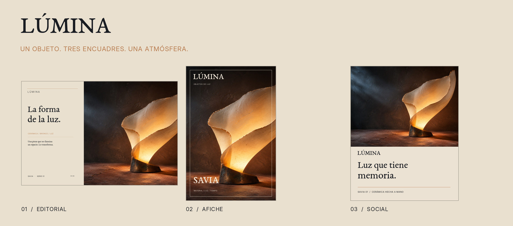

# LÚMINA / SAVIA · IMAGES W003 · 01

**Estado:** obra original raster producida y publicada como JPEG en rama candidata; QA de bytes y visual local verificada. Capturas de navegador y aprobación humana pendientes. `HUMAN_APPROVED=NO`.

**Brief original:** campaña editorial para marca ficticia de luminarias artesanales. Una imagen protagonista y tres piezas adaptadas (editorial, afiche, social) en raster; sistema de encuadres/jerarquías y comparación de consistencia.

## Obra

- `hero_original.png` 1536×1024: imagen protagonista generada especialmente para este encargo. Es una **imagen ilustrativa de diseño imaginario**, no una foto de un producto real a la venta.
- `00_hero_original.jpg` 1536×1024: copia JPG de distribución del mismo arte, sin fingir resolución nativa adicional.
- `01_editorial_3000x2000.jpg`: composición horizontal para doble página editorial. Fotografía a derecha, margen papel y narrativa izquierda.
- `02_poster_1500x2250.jpg`: afiche vertical, encuadre de objeto completo y jerarquía a distancia.
- `03_social_1080x1350.jpg`: publicación digital 4:5, fotografía superior y narrativa tipográfica inferior.
- `04_comparacion_2400x1060.jpg`: atlas comparativo de tres soportes.
- `index.html`: superficie editorial local con imágenes reales, sin botones de control añadidos.
- `render.py`: fuente reproducible con Pillow, requiere `hero_original.png` en el mismo directorio. No redistribuye archivos tipográficos.
- `QA.json`, `media_manifest.json`, `PREPRODUCTION.deep-spec-v1.json`, `TRACE.json`: recibos/decisiones/pruebas.

## Sistema visual reutilizable

**Canon:** SAVIA 01, pantalla cerámica plegada en dos hojas curvas, luz cálida desde el núcleo, base baja de bronce patinado. Identidad mediante silueta, sombra y materiales, no solo logo.

**Paleta:** carbón `#191d22`, marfil `#f3eadb`, cobre `#b77a4c`, papel `#ebe2d4`. Fotografía original conserva contraste de penumbra azulada y luz ámbar.

**Jerarquía:** marca con serif editorial; gran titular dos líneas; indicación pequeña de material; código de serie final. En editorial: campo claro/texto y escena oscura. En afiche: escena full bleed y textos pegados a bordes seguros. En social: foto sobre panel editorial con titular; retícula sin repetir el logo como sustitución visual.

**Encadres:** imagen fuente 1536×1024; foco material aprox. `x=.70`, `y=.54`, prohibido cortar las dos hojas superiores. Tamaños de archivo finales de composición no equivalen a nuevas muestras ópticas. El master NO es apto para un afiche de gran formato a 300 ppp nativos. Se requiere volver a renderizar/ilustrar a resolución objetivo si la pieza pasa a producción impresa.

## Referencias observadas (no usadas como recursos)

- Flos / Michael Anastassiades, *IC Lights*: luz como fenómeno físico y silueta inteligible en penumbra: <https://flos.com/en/us/stories/ic-lights-family.html>.
- Louis Poulsen, *PH 5*: geometría de difusores que cuenta cómo trabaja la luz: <https://www.louispoulsen.com/en-us/products/indoor-lighting/pendants/ph-5>.
- Aesop / campañas editoriales y objeto: tratamiento de materia como still-life: <https://neve.studio/aesop-photography-video-case-study/>.

No se copiaron objetos, fotografías ni tipografías de estas referencias; la fotografía/ilustración original es generada dentro de este encargo.

## QA y límites

- 5 raster descodificados con Pillow: **PASS**.
- Composición y comparación inspeccionadas visualmente: **OBSERVED_LOCAL**.
- No falso upscale: **PASS**, se declara tamaño óptico de la fuente.
- Prueba de navegador Chromium a 390/1440: **NOT_RUN**, entorno bloquea navegación a `file://` y `127.0.0.1` (`ERR_BLOCKED_BY_ADMINISTRATOR`).
- Impresión física, ICC, tipografía en imprenta, A/B ciego y aprobación humana: **NOT_RUN**.
- Raster remoto: **PUBLISHED_CANDIDATE** con JPEG optimizados y hashes de publicación independientes de los originales ZIP. Lectura remota/Pages HTTP e inspección de navegador requieren verificación por separado.

## Comparación W002 vs W003

- Antiguo brief SHA `2e0e5e8ca226d546005349dc44b31cd9abcf5dd1`; nuevo LAUNCH `a97b91ca103847ea75eeb9d1d2af10b6c9c0dddd`.
- W002 auditó ausencia de raster remoto y riesgo de afirmar más resolución óptica que la fuente. W003 produce raster local, deposita JPEG originales de campaña en la nueva ruta candidata y muestra composición en atlas. Publicación de Github ≠ acreditación artística ni prueba de imprenta.
- W003 realizó primer artículo de luminaria y luego multiplicó soportes; los tests de 390/1440 son NOT_RUN y el control artístico no se autoaprueba.
