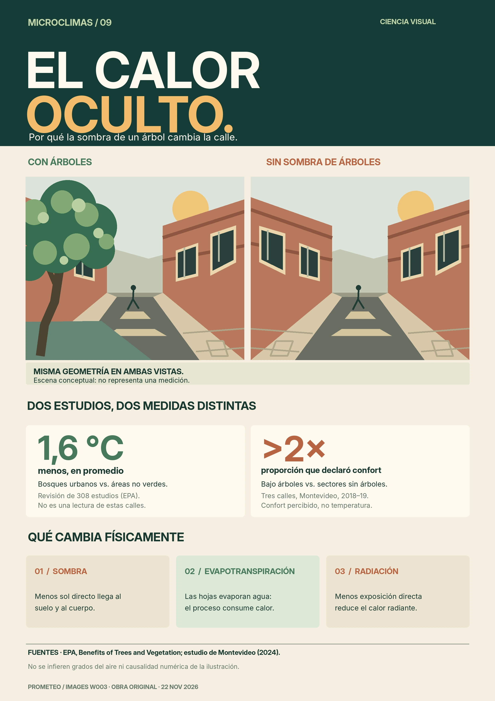

# EL CALOR OCULTO · IMAGES W003 · 09

**Identidad:** `images-w003-20261122-09` · fecha 2026-11-22 · brief histórico W002 sin modificaciones. **Estado:** DELIVERED / TECHNICAL QA OBSERVED / NO HUMAN APPROVAL.

## Obra pública y media real

[Visor responsivo](index.html) · [Ráster A4 2480×3508](el_calor_oculto_A4_300dpi.webp) · [Ráster móvil 780×4100](el_calor_oculto_mobile.webp)

Al abrir el visor, la imagen aparece directamente. La variante móvil es una composición distinta, no un recorte ni una ampliación. Los enlaces de descarga quedan **después** de la imagen: nada invade el protagonista.

**Fuente ejecutable:** [render_heat.py](render_heat.py) (Pillow y Inter local, salida predeterminada junto al script; configurable con `PROMETEO_OUTPUT_DIR`). **Pruebas:** [test_heat.py](test_heat.py), cuatro tests locales ejecutados; [validate_book.mjs](validate_book.mjs) usa los validadores transversales publicados en `prometeo/launch`. **Datos:** [PROCEDENCIA.csv](PROCEDENCIA.csv). **Expediente:** [PREPRODUCTION.deep-spec-v1.json](PREPRODUCTION.deep-spec-v1.json), [QA.md](QA.md), [STAGE_TRACE.json](STAGE_TRACE.json), [RESULT.json](RESULT.json).

## Qué explica y qué NO

La ilustración usa una sola `base_scene()` para las dos vistas. En la arbolada, `tree_scene()` agrega el árbol y su sombra; edificios, persona, sol, calle y horizonte permanecen en el mismo lugar. Es un **diagrama conceptual**, no imagen infrarroja, simulación, termometría ni ensayo físico de una calle real.

- **EPA:** revisión de **308 estudios**, bosques urbanos **1,6 °C más frescos de media** que zonas no verdes. No describe los dos paneles dibujados ni permite inferir su temperatura.
- **Montevideo:** trabajo de campo en **tres calles** durante el verano de 2018–2019; la **proporción** de participantes que declaró confort bajo sombra de árboles fue **más del doble** que la de sectores sin árboles. Es una respuesta subjetiva, **no °C**.
- Los mecanismos físicos atribuidos son interceptación de radiación solar y evapotranspiración. Horario, humedad, viento, orientación y especie importan.

Fuentes originales: [EPA](https://www.epa.gov/heatislands/benefits-trees-and-vegetation) y [artículo de Montevideo](https://pmc.ncbi.nlm.nih.gov/articles/PMC11233938/). No hay mezcla numérica en un gráfico. El póster editorial [The hottest summer ever de SCMP](https://multimedia.scmp.com/culture/article/SCMP-printed-graphics-memory/lonelyGraphics/202309A328.html) se observó como benchmark de jerarquía narrativa y citas, sin copiar medios.

## Cambio respecto de W002

La auditoría W002 señaló fachadas/perspectiva incompatibles entre los dos casos y sombras ajenas en la supuesta escena sin sombra. En W003 se probó una primera ilustración independiente, se **rechazó** porque no respetaba la geometría, y se sustituyó por construcción raster a partir de una sola escena. También se corrigió la etiqueta `>2×` para indicar proporción, no cantidad absoluta de personas. Es un cambio observable de técnica, no una certificación de mejora artística universal.

## Auditoría honesta

- **OBSERVED:** dos WebP auténticos en GitHub con tamaño/hash comprobados; PNG originales locales; composición con mismos hitos geométricos; fuentes científicas; cuatro pruebas unitarias PASS.
- **OBSERVED_LOCAL:** captura Chromium real de 390 y 1440 con las mismas imágenes incrustadas como datos y sin scroll horizontal; [390](QA_browser_390.webp) y [1440](QA_browser_1440.webp).
- **NOT_RUN:** pruebas con usuarios externos, impresión física A4 y colorimetría de imprenta; GET remoto en navegador del host Pages.
- **OPEN QUALITY GAP:** el estilo raster es más esquemático que el benchmark editorial, y algunos rótulos pequeños en terracota no alcanzan 4.5:1. Ver QA.
- **HUMAN_APPROVED:** NO.

Se conservan las ramas, briefs y productos históricos; este worker no promueve el flujo privado de imágenes. Flujo propietario consultado: `JuanManuelPM/pruebas@candidate/prometeo-image-studio-unificado-20261117:sistemas/imagenes/README.md`, SHA blob `5726f13f840884f6c4984d88fa27e89f0be9e2bb`. Su condicionamiento artístico avanzado seguía NOT_VERIFIED, por lo que no se inventa integración con un backend generativo.
